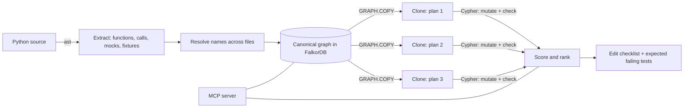

# Preflight

**A flight simulator for code changes.** Before an AI coding agent edits a file, Preflight clones the code graph in
[FalkorDB](https://www.falkordb.com/), tries each rival refactoring on its own clone, and reports what would break,
which tests would catch it, and which breakages would pass **silently** because a test mocks the call away.

Built for **Graph Hacks: Context for AI Agents** (WeMakeDevs x FalkorDB), **Track 01: Agents That Act on Connected Data**.

- Repository: `<GITHUB_URL>`
- Demo video: `<VIDEO_URL>`

## The problem

An AI coding agent picks one refactoring idea, edits files, runs the tests, reads the failures, and repeats.
Two things go wrong:

1. **It learns about breakage one failing test at a time.** A change to a widely used function can touch dozens of call sites.
2. **Green tests can lie.** A test that mocks a function stays green when that function's signature changes.
   If every test that reaches a call site mocks it, nobody finds out until production.

Tools that list "who calls this function" do not answer either question. Preflight simulates the change first.

## What an agent gets (MCP tools)

| Tool | What it does |
|---|---|
| `sync_workspace_graph` | Builds or refreshes the code graph for a folder. Skips all work when no file changed. |
| `inspect_blast_radius` | Callers hop by hop (with a witness path for deep callers), the exact call sites, which tests reach each caller, which tests mock the function, and a PageRank hub score. |
| `simulate_refactor_decisions` | Takes 1 to 5 rival plans (`change_params` or `rename`). Runs each on a **cloned graph**. Returns a ranked comparison, every broken call site with a status, the tests expected to fail, and an ordered edit checklist for the winner. |
| `check_graph_engine` | Health check: clones a tiny graph and reports timings. |

Every broken call site gets one of three statuses:

| Status | Meaning | Who notices |
|---|---|---|
| `caught` | A test that really runs the call would fail. | The agent's test loop. |
| `masked` | Every test that reaches the call mocks it away; tests stay green. | **Nobody.** |
| `untested` | No test path to the caller was found. | **Nobody.** |

### Example (real output, `invoke`, project at the pinned commit in `TARGETS.md`)

Changing `invoke.context.Context.__init__` to take a *required* `settings` parameter breaks 59 call sites.
58 are caught by tests. **One is not:** `invoke.sudo` calls `Context()`, and its only test mocks `Context`.
A test loop would see 58 failures, fix them, and ship the broken `sudo`.

## How it works



1. **Ingest.** Python's `ast` reads every file (the code is never imported or run). Calls, imports, mocks and pytest fixtures
   are resolved across files into one graph. A rename-safe **namespace key** (`ns`) records *which name a call looks up*,
   because `patch("a.b.f")` replaces the name `f` in module `a.b`, not the function everywhere.
2. **Clone.** `GRAPH.COPY` creates an isolated in-memory copy of the whole graph for each plan.
3. **Mutate and check.** The change is applied to the clone with Cypher `SET`; Cypher finds every call that no longer fits.
4. **Rank.** A documented formula scores each plan (lower is safer). Clones are deleted. The real graph is never written to.

## Why FalkorDB

This product does not work without it. The core operations are FalkorDB features:

- **`GRAPH.COPY`**: an isolated clone per rival plan, so a plan can be mutated freely and thrown away.
- **Multi-hop Cypher**: blast radius is one variable-length query (`[:CALLS*1..N]`), and the lying-mock check joins
  `CALLS`, `MOCKS` and `REFERENCES` edges on the namespace key.
- **`algo.pageRank`**: hub detection.
- **`falkordblite`**: an embedded FalkorDB, so there is nothing to install or run besides a Python package.

A plain in-memory graph library would need us to copy and re-implement all of this.

## Data model

Full description: [`docs/SCHEMA.md`](docs/SCHEMA.md). Summary:

- Nodes: `Module`, `Function` (a test is a `Function` with `is_test = true`).
- Relationships: `DEFINED_IN`, `IMPORTS`, `CALLS` (one per call site, with `line`, `n_pos`, `kw_names`, `ns`),
  `REFERENCES` (a function used as a value or fixture), `MOCKS` (`ns`, `scope`, `via`, `file`, `line`).

### The three queries that matter

Blast radius (callers with shortest hop distance):

```cypher
MATCH p=(c:Function)-[:CALLS*1..5]->(f:Function {qname:$q})
RETURN c.qname, min(length(p)) ORDER BY min(length(p))
```

Lying mock (a test mocks `f`, reaches a caller of `f`, and that caller's call goes through the patched name):

```cypher
MATCH (t:Function {is_test:true})-[m:MOCKS]->(f:Function {qname:$q})
MATCH (c:Function)-[k:CALLS]->(f)
WHERE k.ns = m.ns AND (c.qname = t.qname OR (t)-[:CALLS|REFERENCES*1..4]->(c))
RETURN DISTINCT t.qname, m.line, c.qname, k.line
```

A call no longer fits a new signature (checked against the real Python interpreter on 1000 random calls, see `tests/test_mutations.py`):

```cypher
MATCH (c:Function)-[k:CALLS]->(f:Function {qname:$q})
WHERE k.dynamic_args = false
WITH c, k, f,
     k.n_pos > size(f.params) AND NOT f.has_varargs AS too_many,
     [kw IN k.kw_names WHERE NOT kw IN f.params AND NOT kw IN f.kwonly] AS unknown,
     [kw IN k.kw_names WHERE kw IN f.params[0..k.n_pos]] AS dup,
     [r IN f.required WHERE NOT r IN f.params[0..k.n_pos] AND NOT r IN k.kw_names] AS missing
WHERE too_many OR (size(unknown) > 0 AND NOT f.has_varkw) OR size(dup) > 0 OR size(missing) > 0
RETURN c.qname, k.line, too_many, unknown, dup, missing
```

Simulation details and the scoring formula: [`docs/SIMULATION.md`](docs/SIMULATION.md).

## Results

### Does it predict what really breaks? ([`docs/VALIDATION.md`](docs/VALIDATION.md))

For 5 real changes to [cookiecutter](https://github.com/cookiecutter/cookiecutter), the tool predicted which tests would fail.
Then the change was really made in a copy of the code and cookiecutter's real test suite (379 tests) was run.

| | Predicted | Actually failed | In both | Precision | Recall |
|---|---|---|---|---|---|
| 5 experiments | 319 | 310 | 307 | **0.96** | **0.99** |

Reproduce it: `uv run python scripts/validate_prediction.py <cookiecutter> <python-with-test-deps>`.
The experiment also found three bugs in an earlier version (mocks in the middle of a call path, failing `conftest.py`,
`patch()` importing its target); they are fixed and covered by tests.

### Speed

Timings (ingest, `GRAPH.COPY`, blast radius, PageRank, simulating three plans) for cookiecutter, fabric and invoke:
[`docs/BENCHMARK.md`](docs/BENCHMARK.md), produced by `scripts/benchmark.py` on the machine named in that file.
`GRAPH.COPY` forks the database, so clones are created one at a time and then evaluated in parallel.

## Setup

Tested on Windows 11 with WSL2 (Ubuntu 24.04), Python 3.12, [`uv`](https://docs.astral.sh/uv/). **No Docker needed.**
`falkordblite` has no native Windows build, so on Windows work inside WSL2 (Ubuntu 24.04 or newer, glibc 2.39+).

```bash
git clone <GITHUB_URL> preflight && cd preflight
uv sync
uv run pytest tests -q                       # the full test suite
mkdir -p ~/targets && git clone https://github.com/cookiecutter/cookiecutter.git ~/targets/cookiecutter
uv run python -m preflight.ingestion.python.cli ~/targets/cookiecutter --target cookiecutter.generate.generate_files
```

The MCP package is pinned to 1.x (`mcp[cli]>=1.27,<2`): version 2 renamed the server class.

### Connect an agent

**Claude Desktop on Windows, server in WSL** (`%APPDATA%\Claude\claude_desktop_config.json`):

```json
{
  "mcpServers": {
    "preflight": {
      "command": "wsl.exe",
      "args": ["-d", "Ubuntu-24.04", "-e", "bash", "-lc",
               "cd ~/preflight && PREFLIGHT_DB=$HOME/.preflight/desktop.db uv run python -m preflight.server"]
    }
  }
}
```

**Claude Code** (inside WSL): `claude mcp add preflight -- uv run --directory ~/preflight python -m preflight.server`

Then ask: *"Use preflight on `~/targets/cookiecutter`. I want to change `cookiecutter.generate.generate_files`. Compare adding an optional `dry_run` parameter with renaming it. Which is safer?"*
Paths given to the tools are Linux paths. Tools sync the workspace themselves, so no setup call is required.

## Watch it work (live view)

Start `uv run python -m preflight.viewer` on the side and every tool call appears as it happens: the clones being created,
each plan's verdict and score, and the timings. With `scripts/start_browser.sh` the official FalkorDB Browser shows the graphs,
including one clone per plan. Setup and demo steps: [`docs/LIVE_VIEW.md`](docs/LIVE_VIEW.md).

## Data used

Only public open-source projects, pinned to exact commits in [`TARGETS.md`](TARGETS.md): cookiecutter, invoke, fabric.
Nothing private and no employer code or data.

## Limits (read before trusting a result)

- **Python only.** Two mutation kinds: `change_params` and `rename`. Return-value changes are not simulated.
- **Static analysis.** Calls through objects of unknown type are not resolved, and are counted, not guessed
  (call resolution on the three projects: 94 to 99.5 percent of project-internal calls).
- **`untested` means "no test path found in the graph".** Python calls some code implicitly (dunder methods, properties),
  so treat `untested` as an upper bound and check by hand.
- **Early exits.** A test that reaches a call but exits before it (for example `--help`) is predicted as failing when it is not.
  Subprocess tests are invisible. Both are visible in the validation results.
- **Small validation.** 5 experiments on 1 project show the method works; they do not prove it works everywhere.
- **Scoring weights are a judgment**, not a measurement. They are in one place (`preflight/simulate.py`) and documented.

## Prior art

Several open-source tools already build code graphs and answer "what calls this" (for example FalkorDB's own Code-Graph,
Gristle, codebase-graph, CodeGraphContext). I read their descriptions and did not test them. Preflight's difference is the
**simulation of rival changes on cloned graphs** and the **analysis of mocks and test paths**; its parser is its own.

## How this was built

I used an AI assistant (Claude, by Anthropic) as a pair programmer for code, tests and documentation.
`<EDIT THIS: say in your own words what you decided, designed and verified yourself, for example the project idea,
the scope, the choice of tracks, the check of results against real test runs and grep.>`
Third-party libraries: FalkorDB / falkordblite, the MCP Python SDK, pytest, pydantic.

## Repository layout

```
preflight/            server.py (MCP tools), queries.py (blast radius), mutations.py + simulate.py (simulation),
                      schema.py (graph contract), db.py, core.py
preflight/viewer.py   live activity feed (python -m preflight.viewer), events.py (event log)
preflight/ingestion/python/   discover, extract, mocks, resolve, pipeline, cli
tests/                rule checks, real-interpreter oracle, property tests, real-repo checks, viewer tests
scripts/              validate_prediction.py, benchmark.py, start_browser.sh
docs/                 SCHEMA.md, SIMULATION.md, VALIDATION.md, BENCHMARK.md, LIVE_VIEW.md
```

## License

MIT, see [`LICENSE`](LICENSE).
