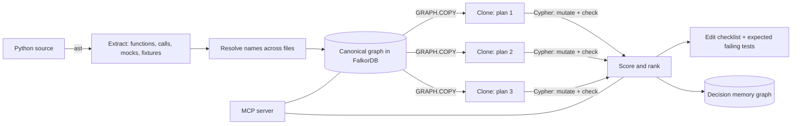

# Preflight

**A flight simulator for code changes.** Before an AI coding agent edits a file, Preflight clones the code graph in
[FalkorDB](https://www.falkordb.com/), tries each rival plan on its own clone, and tells you what would break,
which tests would catch it, and which breakages would pass **silently** because a test mocks the call away.

Built for **Graph Hacks: Context for AI Agents** (WeMakeDevs x FalkorDB). Main entry: **Track 01, Agents That Act on Connected Data**.
It also enters **Track 02, Agent Memory and Coordination**, through the decision memory described below.

## The problem

An AI coding agent picks one idea, edits files, runs the tests, reads the failures, and repeats. Two things go wrong:

1. **It learns about breakage one failing test at a time.** Changing a widely used function can touch dozens of call sites.
2. **Green tests can lie.** A test that mocks a function stays green when that function's signature changes.
   If every test that reaches a call site mocks it, nobody finds out until production.

Tools that list "who calls this function" answer neither question. Preflight simulates the change first.

## What you get

| Tool (MCP) | What it does |
|---|---|
| `sync_workspace_graph` | Builds or refreshes the code graph for a folder. Skips all work when no file changed. |
| `inspect_blast_radius` | Callers hop by hop (with a witness path for deep callers), the exact call sites, which tests reach each caller, which tests mock the function, and a PageRank hub score. |
| `simulate_refactor_decisions` | Takes 1 to 5 rival plans. Runs each on a **cloned graph**. Returns a ranked comparison, every broken call site with a status, the tests expected to fail, and an ordered edit checklist for the winner. |
| `recall_decisions` | **Memory.** Earlier decisions about a function and the functions near it, or the open work to continue. |
| `update_decision` | **Memory.** Claim a decision (refused if another agent holds it), hand it back, or report `applied` / `abandoned` with notes. |
| `check_graph_engine` | Health check: clones a tiny graph and reports timings. |

Every broken call site gets one of three statuses:

| Status | Meaning | Who notices |
|---|---|---|
| `caught` | A test that really runs the call would fail. | The agent's test loop. |
| `masked` | Every test that reaches the call mocks it away; tests stay green. | **Nobody.** |
| `untested` | No test path to the caller was found. | **Nobody.** |

## Try it on your own project

You do not need an AI agent for this. Three commands work on any Python project that is on your disk.

### What you need

- Linux, macOS, or Windows with **WSL2** (Ubuntu 24.04 or newer). Tested on Ubuntu 24.04, on Windows through WSL2 and on plain Linux. macOS should work but was not tested.
  `falkordblite` (the embedded FalkorDB used here) has no native Windows build.
- [`uv`](https://docs.astral.sh/uv/) and `git`. Python 3.12 or newer (`uv` fetches it). **No Docker.**
- The project you want to analyze: **a Python project** (see the limits below). You do not need to install its dependencies, and nothing of it is run.

### Install

Clone or download this repository into `~/preflight`, then:

```bash
cd ~/preflight
uv sync
uv run pytest tests -q          # optional: the test suite of Preflight itself
```

### Run

```bash
# 1. Build the graph and see an overview. Lists the functions whose tests mock them the most (good ones to try).
uv run python -m preflight.ingestion.python.cli ~/work/myproject

# 2. Look at one function: callers, tests that reach it, tests that mock it.
uv run python -m preflight.ingestion.python.cli ~/work/myproject --target mypackage.module.function

# 3. Compare rival changes to that function. Nothing in your project is changed.
uv run python -m preflight.simulate_cli ~/work/myproject mypackage.module.function \
    --plan "optional=add:strict=" \
    --plan "required=add:strict" \
    --plan "drop=remove:old_param" \
    --plan "rename=rename:better_name" \
    --plan "rename_keep=rename+alias:better_name"
```

**Function names** are the dotted name Python would import, starting at the top package: `mypackage.module.function`, or
`mypackage.module.Class.method`. If your code lives in a `src/` folder, leave `src` out. If a name is wrong, the tools suggest close ones.

**Plans** are written `NAME=ACTION`. Use 1 to 5 plans. Parameters never include `self` or `cls`.

| Action | Meaning |
|---|---|
| `add:name` | Add a **required** parameter (after the existing ones). |
| `add:name=` | Add an **optional** parameter (it has a default). |
| `remove:name` | Remove a parameter. |
| `params:a,b=,*,k` | The **complete** new parameter list. `=` marks a default, `*` starts keyword-only parameters. |
| `rename:new_name` | Rename the function or method. |
| `rename+alias:new_name` | Rename it and keep the old name working. |

### How to read the result

- Plans are listed **safest first**. A plan marked `dead_end` is invalid (for example, a required parameter after an optional one, or a name that already exists); the reason is shown.
- Broken call sites are listed **silent ones first** (`masked`, then `untested`, then `caught`), with the file, the line, the reason, and how many tests reach or mock the call.
- `tests expected to fail` is the list an agent should run after the edit. `Edit checklist` is the winner's ordered list of edits.
- The first lines show how much of your project was understood, for example `99.5% of project-internal calls` resolved. A low number means your code uses a lot of dynamic Python (see below), and the results are less complete.

### What it can and cannot analyze

| Area | What to expect |
|---|---|
| **Language** | **Python only.** Other languages are ignored. In a mixed repository only the Python files are analyzed. Files with syntax errors are skipped and counted. |
| **Analysis** | **Static.** Nothing is imported or run, so it works without your dependencies. Calls through objects of unknown type, `getattr`, metaprogramming and plugins are not resolved: they are counted, not guessed. |
| **Tests** | Needed for useful answers. A test is a `test*` function in a test file (a `test`, `tests`, `testing`, `integration` or `e2e` folder, or `test_*.py` / `*_test.py`), or any public function there if the project uses the `pytest-relaxed` plugin (detected from its config files). **A project with no tests reports every broken call as `untested`.** |
| **Mocks understood** | `unittest.mock.patch`, `patch.object`, `patch.multiple` (as decorator, `with`, or call), pytest-mock `mocker.patch`, `monkeypatch.setattr`, and pytest fixtures (including `autouse`, `conftest.py` and fixtures that use fixtures). |
| **Mocks not understood** | Other mocking libraries, hand-written fakes, `autospec=True` signature checks, and patches made inside helper functions that a test calls. |
| **Changes simulated** | Parameters (add, remove, new list) and renames, for functions and methods. **Not simulated:** return-value changes, moving a function, sync/async changes, class-level and decorator changes. |
| **Call sites** | A call that uses `*args` or `**kwargs` cannot be checked. It is counted as "unverifiable", not as broken. |
| **Test reach** | A test is linked to a function if it reaches it through up to 4 calls, references, or fixtures. Longer chains are missed. |
| **Skipped** | Hidden folders (`.git`, `.venv`), `build`, `dist`, `docs`, `venv`, `env`, `node_modules`, `site-packages`, vendored code (`vendor`, `vendored`, `_vendor`, `third_party`), `*.egg-info`, files over 1 MB, and files in folders whose names are not valid Python names. |
| **Prediction errors** | "Tests expected to fail" can include tests that exit early (for example `--help`), and cannot see tests that run your code in a subprocess. The measured accuracy is below. |
| **Size and projects tested** | Run on 8 open source projects: cookiecutter, fabric, invoke, flask, requests, httpx, gunicorn, black. The largest was gunicorn (4,883 functions, 2,512 tests): about 2 seconds to parse and 0.7 seconds to build the graph. Call resolution ranged from 81% (flask, very dynamic code) to 99%. Much larger projects were not tested. |

## Use it from an AI agent (MCP)

Preflight is an MCP server. Start it with this command: `uv run --directory ~/preflight python -m preflight.server`.
It was tested with **Claude Desktop**; any MCP client that can start a stdio server can use the same command (others were not tested).

**Claude Desktop on Windows, server in WSL** (`%APPDATA%\Claude\claude_desktop_config.json`):

```json
{
  "mcpServers": {
    "preflight": {
      "command": "wsl.exe",
      "args": ["-d", "Ubuntu-24.04", "-e", "bash", "-lc",
               "cd ~/preflight && PREFLIGHT_DB=$HOME/.preflight/desktop.db uv run python -m preflight.server"]
    }
  }
}
```

**Claude Desktop on Linux or macOS** (use the absolute path of the folder):

```json
{
  "mcpServers": {
    "preflight": {
      "command": "uv",
      "args": ["run", "--directory", "/absolute/path/to/preflight", "python", "-m", "preflight.server"]
    }
  }
}
```

Quit and reopen the client, then ask, for example: *"Use preflight on `~/work/myproject`. I want to change `mypackage.module.function`.
Compare adding an optional parameter with renaming it. Which is safer, and what would the tests not catch?"*
Paths given to the tools are paths on the machine where the server runs. The tools sync the workspace themselves; no setup call is needed.

## Example on a real project

On the open source project [invoke](https://github.com/pyinvoke/invoke): making `Context.__init__` take a *required* `settings` parameter
breaks 59 call sites. 58 are caught by tests. **One is not:** `invoke.sudo` calls `Context()`, and its only test replaces `Context` with a fake
that accepts anything. A test loop would see 58 failures, fix them, and ship the broken `sudo`. (Numbers come from the version of invoke we tested and can differ slightly in other versions.)

## How it works



1. **Ingest.** Python's `ast` reads every file (the code is never imported or run). Calls, imports, mocks and pytest fixtures
   are resolved across files into one graph. A **namespace key** (`ns`) records *which name a call looks up*, because
   `patch("a.b.f")` replaces the name `f` in module `a.b`, not the function everywhere.
2. **Clone.** `GRAPH.COPY` creates an isolated in-memory copy of the whole graph for each plan.
3. **Mutate and check.** The change is applied to the clone with Cypher `SET`; Cypher finds every call that no longer fits.
4. **Rank.** A documented formula scores each plan (lower is safer). Clones are deleted. The real graph is never written to.

## Why FalkorDB

This product does not work without it. The core operations are FalkorDB features:

- **`GRAPH.COPY`**: an isolated clone per rival plan, so a plan can be mutated freely and thrown away.
- **Multi-hop Cypher**: blast radius is one variable-length query (`[:CALLS*1..N]`), and the lying-mock check joins
  `CALLS`, `MOCKS` and `REFERENCES` edges on the namespace key.
- **`algo.pageRank`**: hub detection.
- **One graph per workspace and per plan** in a single instance: the code graph, one clone per plan, and one memory graph.
- **`falkordblite`**: an embedded FalkorDB, so there is nothing to install or run besides a Python package.

`GRAPH.COPY` forks the database, so clones are created one at a time and then evaluated in parallel.

## Memory across sessions and agents

Every simulation is saved as a **decision** in its own memory graph in FalkorDB (one per workspace, separate from the code graph,
so it survives code changes). A later agent, in another session, sees what was decided, which plans were compared, which silent breaks
were found, who owns the work, and what happened. A claim is one atomic Cypher query, so two agents cannot take the same job.
It remembers decisions, not conversations. Details, graph model, tests and limits: [`docs/MEMORY.md`](docs/MEMORY.md).

## Data model

Full description: [`docs/SCHEMA.md`](docs/SCHEMA.md). Summary:

- Nodes: `Module`, `Function` (a test is a `Function` with `is_test = true`).
- Relationships: `DEFINED_IN`, `IMPORTS`, `CALLS` (one per call site, with `line`, `n_pos`, `kw_names`, `ns`),
  `REFERENCES` (a function used as a value or fixture), `MOCKS` (`ns`, `scope`, `via`, `file`, `line`).

### The three queries that matter

Blast radius (callers with shortest hop distance):

```cypher
MATCH p=(c:Function)-[:CALLS*1..5]->(f:Function {qname:$q})
RETURN c.qname, min(length(p)) ORDER BY min(length(p))
```

Lying mock (a test mocks `f`, reaches a caller of `f`, and that caller's call goes through the patched name):

```cypher
MATCH (t:Function {is_test:true})-[m:MOCKS]->(f:Function {qname:$q})
MATCH (c:Function)-[k:CALLS]->(f)
WHERE k.ns = m.ns AND (c.qname = t.qname OR (t)-[:CALLS|REFERENCES*1..4]->(c))
RETURN DISTINCT t.qname, m.line, c.qname, k.line
```

A call no longer fits a new signature (checked against the real Python interpreter on 1000 random calls, see `tests/test_mutations.py`):

```cypher
MATCH (c:Function)-[k:CALLS]->(f:Function {qname:$q})
WHERE k.dynamic_args = false
WITH c, k, f,
     k.n_pos > size(f.params) AND NOT f.has_varargs AS too_many,
     [kw IN k.kw_names WHERE NOT kw IN f.params AND NOT kw IN f.kwonly] AS unknown,
     [kw IN k.kw_names WHERE kw IN f.params[0..k.n_pos]] AS dup,
     [r IN f.required WHERE NOT r IN f.params[0..k.n_pos] AND NOT r IN k.kw_names] AS missing
WHERE too_many OR (size(unknown) > 0 AND NOT f.has_varkw) OR size(dup) > 0 OR size(missing) > 0
RETURN c.qname, k.line, too_many, unknown, dup, missing
```

Simulation details and the scoring formula: [`docs/SIMULATION.md`](docs/SIMULATION.md).

## Results

### Does it predict what really breaks? ([`docs/VALIDATION.md`](docs/VALIDATION.md))

For 5 real changes to [cookiecutter](https://github.com/cookiecutter/cookiecutter), the tool predicted which tests would fail.
Then the change was really made in a copy of the code and cookiecutter's real test suite (379 tests) was run.

| | Predicted | Actually failed | In both | Precision | Recall |
|---|---|---|---|---|---|
| 5 experiments | 319 | 310 | 307 | **0.96** | **0.99** |

The first version scored precision 0.94 and recall 0.98. Comparing with the real suite exposed two flaws that changed the
numbers (a mock in the middle of a call path cuts the path; `patch()` imports its target), now fixed and covered by tests.
Each fix was switched off on its own to measure it: see `docs/VALIDATION.md`.
This is 5 experiments on 1 project: it shows the method works, not that it works everywhere.

**Check your own project the same way:** `scripts/validate_prediction.py` makes a real change in a copy of your project, runs your real
tests, and compares. How: [`docs/VALIDATION.md`](docs/VALIDATION.md).

### Speed

`uv run python scripts/benchmark.py ~/work/projectA ~/work/projectB` measures parsing, graph loading, `GRAPH.COPY`, the blast radius query,
PageRank, and simulating three plans on your projects, and writes the table to `docs/BENCHMARK.md`.

## Watch it work (live view)

Start `uv run python -m preflight.viewer` on the side and every tool call appears as it happens: the clones being created,
each plan's verdict and score, and the timings. With `scripts/start_browser.sh` the official FalkorDB Browser shows the graphs,
including one clone per plan, labeled so the Browser colors what changed and what breaks. Setup and a guide to reading it: [`docs/LIVE_VIEW.md`](docs/LIVE_VIEW.md).

## Prior art

Several open-source tools already build code graphs and answer "what calls this" (for example FalkorDB's own Code-Graph,
Gristle, codebase-graph, CodeGraphContext). Their descriptions were read; they were not tested here. Preflight's difference is the
**simulation of rival changes on cloned graphs**, the **analysis of mocks and test paths**, and the **decision memory**; its parser is its own.

## How this was built

Preflight was built with an AI assistant (Claude, by Anthropic) as a pair programmer: it wrote most of the code, tests and documentation
under the author's direction. The author chose the idea, the scope and the target projects, ran the tool through Claude Desktop, and
reproduced the validation experiment independently on their own machine. Results were checked against the real test suites of the target
projects and by reading their source. Third-party libraries: FalkorDB / falkordblite, the MCP Python SDK, pytest, pydantic.

## Repository layout

```
preflight/            server.py (MCP tools), queries.py (blast radius), mutations.py + simulate.py (simulation),
                      memory.py (decision memory), schema.py (graph contract), db.py, core.py,
                      simulate_cli.py (compare plans from the terminal), viewer.py + events.py (live view)
preflight/ingestion/python/   discover, extract, mocks, resolve, pipeline, cli
tests/                rule checks, real-interpreter oracle, property tests, memory, viewer and command-line tests
scripts/              validate_prediction.py, benchmark.py, start_browser.sh
docs/                 SCHEMA.md, SIMULATION.md, VALIDATION.md, MEMORY.md, LIVE_VIEW.md
```

## License

MIT, see [`LICENSE`](LICENSE).
