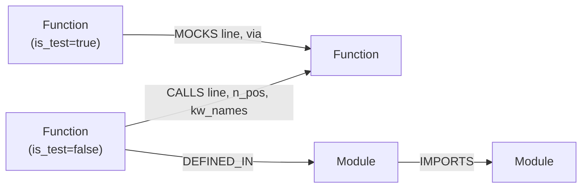

# Graph data model

The canonical graph holds one workspace. `preflight/schema.py` is the single source of truth for every name below.



## Nodes

| Label | Key properties |
|---|---|
| `Module` | `qname`, `file`, `sha256` |
| `Function` | `qname` (unique key), `name`, `module`, `file`, `line`, `end_line`, `params`, `kwonly`, `required`, `has_varargs`, `has_varkw`, `returns`, `is_async`, `is_method`, `is_test`, `class_name` |

A test is a `Function` with `is_test = true`.
For methods, `params` leaves out the leading `self` or `cls`.

## Relationships

| Relationship | Properties | Meaning |
|---|---|---|
| `(Function)-[:DEFINED_IN]->(Module)` | none | where the function lives |
| `(Module)-[:IMPORTS]->(Module)` | none | file dependency |
| `(Function)-[:CALLS]->(Function)` | `line`, `n_pos`, `kw_names`, `dynamic_args`, `ns` | one call site |
| `(Function)-[:MOCKS]->(Function)` | `line`, `via`, `ns`, `scope`, `file` | a test replaces this function |

## Indexes

`Function.qname`, `Function.file`, `Module.qname`.

## The two core queries

Blast radius (who is affected, hop by hop):

```cypher
MATCH p=(c:Function)-[:CALLS*1..5]->(f:Function {qname:$q})
RETURN c.qname, length(p) ORDER BY length(p)
```

Lying mock (a test mocks `f`, reaches a caller of `f`, and that caller's call goes through the patched name):

```cypher
MATCH (t:Function {is_test:true})-[m:MOCKS]->(f:Function {qname:$q})
MATCH (c:Function)-[k:CALLS]->(f)
WHERE k.ns = m.ns AND (c.qname = t.qname OR (t)-[:CALLS*1..4]->(c))
RETURN DISTINCT t.qname, m.line, m.scope, c.qname, k.line
```

## The namespace key `ns` (why the query is precise)

`patch("a.b.f")` replaces the **name** `f` inside module `a.b`. It does not replace the original function everywhere.
A caller that wrote `from a.b import f` keeps its own copy of the name, so that patch does **not** reach it.
Every call and every patch therefore carries `ns`, and only equal keys count as "mocked":

| Code | `ns` |
|---|---|
| `f()` inside module `X` (defined or imported there) | `X.f` |
| `mod.f()` where `mod` is module `a.b` | `a.b.f` |
| `self.m()` resolved to a method | the method's qname |
| `patch("a.b.f")` | `a.b.f` |

`MOCKS.scope` says where the patch lives: `decorator`, `body`, `class_decorator`, `class_setup`, `fixture:<name>` or `autouse:<name>`.
